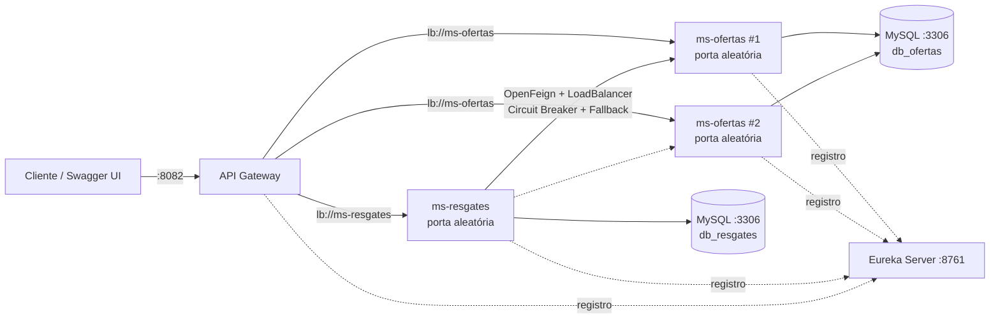

# Circuito Zero Desperdício — Microsserviços

> *Comida que sobra no balcão, na mesa de quem precisa.*

Global Solution 2026/2 · FIAP · 3º SIPF — **Microservice and Web Engineering & IT Services**

## Integrantes

| Nome | RM |
|---|---|
| Davi Fiszbejn | RM557716 |
| Leonardo da Silva de Oliveira | RM557333 |
| Augusto Tomaselli | RM555916 |

---

## O problema

No fim do expediente, restaurantes, padarias e pequenos comércios de bairro descartam alimentos em
perfeitas condições. Ao mesmo tempo, ONGs, cozinhas solidárias e líderes comunitários a poucos
quarteirões enfrentam insegurança alimentar e **não sabem que essa comida existe**.
O maior entrave não é a vontade de doar, e sim a **logística**: a sobra aparece no fim do turno e
perde qualidade em poucas horas.

## A solução

Uma plataforma de **redistribuição relâmpago** de excedentes alimentares focada no comércio de bairro:

1. **Sinaliza** — perto do fim do turno o comerciante registra o excedente (ex.: 20 pães e 5 marmitas).
2. **Alerta** — instituições cadastradas num raio curto veem a oferta disponível.
3. **Reserva** — a primeira instituição que reservar garante a doação.
4. **Retira** — a coleta é feita a pé ou em trajetos curtíssimos, sem custo.

Este repositório implementa o backend dessa solução com **dois microsserviços** que conversam de forma
**síncrona**:

| Microsserviço | Responsabilidade | Banco próprio |
|---|---|---|
| **ms-ofertas** | Excedentes sinalizados pelos comércios e o status de cada oferta | MySQL `db_ofertas` |
| **ms-resgates** | Reservas/retiradas feitas pelas instituições sociais | MySQL `db_resgates` |

Os dois bancos ficam no mesmo servidor MySQL (porta 3306), mas são **schemas separados**: cada
microsserviço acessa apenas o seu, sem compartilhar tabelas.

---

## Arquitetura



| Componente | Tecnologia | Porta |
|---|---|---|
| eureka-server | Spring Boot 3.5 · Spring Cloud Netflix Eureka | **8761** |
| api-gateway | Spring Boot 3.5 · Spring Cloud Gateway + LoadBalancer · Swagger UI unificado | **8082** |
| ms-ofertas | **Java 25 · Spring Boot 4.0.9** · JPA · Flyway · MySQL · springdoc | aleatória (`server.port=0`) |
| ms-resgates | **Java 25 · Spring Boot 4.0.9** · JPA · Flyway · MySQL · OpenFeign · Resilience4j · springdoc | aleatória (`server.port=0`) |
| mysqldb | MySQL 8.4.6 (Docker, container `mysql_circuito_zero`) | **3306** |

**Não há URLs fixas entre os serviços**: o ms-resgates chama `@FeignClient(name = "ms-ofertas")`, o nome
é resolvido no Eureka e o Spring Cloud LoadBalancer escolhe uma das instâncias a cada chamada.

### Organização em camadas (cada microsserviço)

```
src/main/java/br/com/fiap/ms_xxx/
├── controller/     → endpoints REST /api/v1/... (ResponseEntity; só conversa com o Service)
├── service/        → regras de negócio, CRUD, transições de status, exceções
├── repositories/   → Spring Data JPA
├── entities/       → entidades JPA + enum de status
├── dto/            → *RequestDTO (entrada, com Bean Validation) e *ResponseDTO (saída)
├── client/         → (ms-resgates) OpenFeign client do ms-ofertas
├── config/         → (só no ms-resgates) FeignConfig, com o ErrorDecoder do Feign
└── exceptions/     → exceções customizadas + GlobalExceptionHandler (@RestControllerAdvice)
src/main/resources/
├── application.properties       → nome, perfil ativo (dev), porta, Eureka, Swagger (+ Feign/Resilience4j)
├── application-dev.properties   → MySQL, JPA e Flyway
├── application-test.properties  → H2 em memória (usado nos testes)
└── db/migration/
    ├── V1__create_*.sql            → criação da tabela (Flyway)
    └── V2__insert_initial_data.sql → carga inicial (Flyway)
```

### Perfis

| Perfil | Quando | Banco |
|---|---|---|
| `dev` (padrão, `spring.profiles.active=dev`) | execução normal | MySQL `localhost:3306` (`db_ofertas` / `db_resgates`), usuário `root`, senha `root` |
| `test` | testes automatizados (`@ActiveProfiles("test")`) | H2 em memória (modo MySQL), console em `/h2-console`, Eureka desligado |

### Entidades e status

**Oferta** (`ms-ofertas`): `id`, `comercioNome`, `descricao`, `quantidade`, `endereco`,
`dataLimiteRetirada`, `criadoEm`, **`status`**

**Resgate** (`ms-resgates`): `id`, `ofertaId`, `instituicaoNome`, `responsavelNome`, `telefone`,
`dataReserva`, `dataRetirada`, **`status`**

### Comunicação síncrona e alteração de status

Cada ação do ms-resgates altera **o status nos dois serviços** via OpenFeign:

| Ação no ms-resgates | Chamada Feign ao ms-ofertas | Oferta | Resgate |
|---|---|---|---|
| `POST /api/v1/resgates` | `PATCH /api/v1/ofertas/{id}/reservar` | DISPONIVEL → **RESERVADA** | **RESERVADO** (201) |
| `PATCH /api/v1/resgates/{id}/retirar` | `PATCH /api/v1/ofertas/{id}/retirar` | RESERVADA → **RETIRADA** | RESERVADO → **RETIRADO** |
| `PATCH /api/v1/resgates/{id}/cancelar` | `PATCH /api/v1/ofertas/{id}/liberar` | RESERVADA → **DISPONIVEL** | → **CANCELADO** |
| `PATCH /api/v1/resgates/{id}/confirmar` | `PATCH /api/v1/ofertas/{id}/reservar` | DISPONIVEL → **RESERVADA** | CONFIRMACAO_PENDENTE → **RESERVADO** |

### Circuit Breaker e Fallback (Resilience4j)

Os endpoints acima são anotados com `@CircuitBreaker(name = "ms-ofertas", fallbackMethod = ...)`:

- **POST com o ms-ofertas fora do ar** → o fallback **não perde o pedido**: salva o resgate como
  `CONFIRMACAO_PENDENTE` e responde **503 Service Unavailable** com os dados do resgate no corpo.
  Quando o ms-ofertas voltar, basta chamar `PATCH /api/v1/resgates/{id}/confirmar`.
- **retirar / cancelar / confirmar com o ms-ofertas fora** → nada é alterado e a resposta é **503**.
- Erros de negócio do ms-ofertas (**404** oferta inexistente, **409** oferta já reservada) são
  convertidos pelo `ErrorDecoder` e devolvidos ao cliente como estão: **não** acionam o fallback
  nem contam como falha do circuito (`ignore-exceptions`).

Parâmetros (`ms-resgates/src/main/resources/application.properties`):

| Parâmetro | Valor |
|---|---|
| `sliding-window-type` | `COUNT_BASED` |
| `sliding-window-size` | `3` |
| `minimum-number-of-calls` | `2` |
| `failure-rate-threshold` | `50` (%) |
| `wait-duration-in-open-state` | `20s` |
| `permitted-number-of-calls-in-half-open-state` | `2` |

Ou seja: com 2 falhas o circuito **abre** e, durante 20 s, as chamadas vão direto ao fallback, sem
tentar o ms-ofertas. Depois disso ele passa para *half-open* e testa 2 chamadas.

### Códigos HTTP

| Código | Quando |
|---|---|
| 200 | consultas, atualizações e mudanças de status |
| 201 | criação (`POST`) com header `Location` apontando para o recurso criado |
| 204 | exclusão (`DELETE`) |
| 400 | JSON malformado ou parâmetro de tipo inválido (ex.: `/ofertas/abc`) |
| 404 | recurso inexistente |
| 409 | regra de negócio violada (ex.: reservar oferta já RESERVADA, excluir resgate RESERVADO) |
| 422 | erro de validação dos campos (lista os campos inválidos) |
| 503 | ms-ofertas indisponível (fallback); no POST o resgate é salvo como `CONFIRMACAO_PENDENTE` |

---

## Como executar (a partir de um ambiente limpo)

### Pré-requisitos

- **JDK 25** (ou superior) com `JAVA_HOME` configurado
- **Docker Desktop** (para o MySQL)
- Não é preciso instalar o Maven: cada projeto tem o Maven Wrapper (`mvnw` / `mvnw.cmd`)
- Portas livres: **8761**, **8082** e **3306**

### 1. Clonar o repositório

```bash
git clone <URL-DO-REPOSITORIO>
cd circuito-zero-microservices
```

### 2. Subir o MySQL (Docker)

```bash
docker compose up -d
docker compose ps        # container mysql_circuito_zero em execução
```

Sobe um MySQL 8.4.6 na porta **3306** (usuário `root`, senha `root`). Aguarde uns 20 segundos na
primeira vez, enquanto o MySQL inicializa.

> **Os bancos `db_ofertas` e `db_resgates`, as tabelas e os dados iniciais são criados
> automaticamente** quando cada microsserviço sobe (`createDatabaseIfNotExist=true` + Flyway).

> **Já tem o MySQL das aulas rodando na 3306** (ex.: container `mysql_846` com senha `root`)?
> Pode usá-lo no lugar do `docker-compose.yml` deste projeto, porque os bancos são criados
> automaticamente. Só não suba os dois ao mesmo tempo, já que ambos usam a porta 3306.

### 3. Subir os serviços — nesta ordem, cada um em um terminal

| # | Serviço | Linux / macOS / Git Bash | Windows (PowerShell / CMD) |
|---|---|---|---|
| 1 | Eureka Server | `cd eureka-server && ./mvnw spring-boot:run` | `cd eureka-server; .\mvnw.cmd spring-boot:run` |
| 2 | API Gateway | `cd api-gateway && ./mvnw spring-boot:run` | `cd api-gateway; .\mvnw.cmd spring-boot:run` |
| 3 | ms-ofertas (instância 1) | `cd ms-ofertas && ./mvnw spring-boot:run` | `cd ms-ofertas; .\mvnw.cmd spring-boot:run` |
| 4 | ms-ofertas (instância 2) | *mesmo comando, em outro terminal* | *mesmo comando, em outro terminal* |
| 5 | ms-resgates | `cd ms-resgates && ./mvnw spring-boot:run` | `cd ms-resgates; .\mvnw.cmd spring-boot:run` |

Como os microsserviços usam **porta aleatória** (`server.port=0`), é possível subir quantas instâncias
quiser: basta repetir o comando. Os microsserviços sobem com o perfil **dev** (MySQL) por padrão.

**Pelo IntelliJ IDEA:** abra cada pasta como projeto Maven (ou adicione os 4 `pom.xml` como módulos Maven)
e execute as classes `*Application`. Para várias instâncias do mesmo serviço:
*Run → Edit Configurations → Modify options → **Allow multiple instances***.

### 4. Conferir

- **Eureka:** http://localhost:8761 → devem aparecer `API-GATEWAY`, `MS-OFERTAS` (2 instâncias) e `MS-RESGATES`
- Aguarde ~30 s após o registro para o Gateway atualizar a lista de instâncias.

---

## Documentação Swagger / OpenAPI

### Swagger unificado (API Gateway)

**http://localhost:8082/swagger-ui/index.html**

Use o seletor **"Select a definition"** (canto superior direito) para alternar entre `ms-ofertas` e
`ms-resgates`. A lista é montada dinamicamente a partir do Eureka (classe
`api-gateway/.../config/DynamicSwaggerConfig`, atualizada a cada 10 s), e o **"Try it out"** executa
as requisições pelo Gateway.

### Swagger de cada serviço (também pelo Gateway)

| Serviço | Swagger UI |
|---|---|
| ms-ofertas | http://localhost:8082/ms-ofertas/swagger-ui.html |
| ms-resgates | http://localhost:8082/ms-resgates/swagger-ui.html |

JSON OpenAPI: `http://localhost:8082/ms-ofertas/v3/api-docs` e `http://localhost:8082/ms-resgates/v3/api-docs`.

---

## Endpoints (todos via Gateway `http://localhost:8082`)

### ms-ofertas — `/ms-ofertas/api/v1/ofertas`

| Método | Rota | Descrição |
|---|---|---|
| GET | `/api/v1/ofertas?status=DISPONIVEL` | lista (filtro opcional por status) |
| GET | `/api/v1/ofertas/{id}` | busca por ID |
| POST | `/api/v1/ofertas` | cria oferta (status inicial `DISPONIVEL`) |
| PUT | `/api/v1/ofertas/{id}` | atualiza (somente se `DISPONIVEL`) |
| DELETE | `/api/v1/ofertas/{id}` | exclui (não permitido se `RESERVADA`) |
| PATCH | `/api/v1/ofertas/{id}/reservar` | DISPONIVEL → RESERVADA *(usado pelo Feign)* |
| PATCH | `/api/v1/ofertas/{id}/retirar` | RESERVADA → RETIRADA *(usado pelo Feign)* |
| PATCH | `/api/v1/ofertas/{id}/liberar` | RESERVADA → DISPONIVEL *(usado pelo Feign)* |
| PATCH | `/api/v1/ofertas/{id}/cancelar` | DISPONIVEL → CANCELADA (comércio desistiu) |
| GET | `/api/v1/ofertas/instancia` | porta da instância que respondeu (demo do Load Balancer) |

### ms-resgates — `/ms-resgates/api/v1/resgates`

| Método | Rota | Descrição |
|---|---|---|
| GET | `/api/v1/resgates?status=RESERVADO` | lista (filtro opcional por status) |
| GET | `/api/v1/resgates/{id}` | busca por ID |
| POST | `/api/v1/resgates` | reserva uma oferta (**Feign → ms-ofertas**) |
| PUT | `/api/v1/resgates/{id}` | atualiza dados de contato |
| DELETE | `/api/v1/resgates/{id}` | exclui (se `RESERVADO`, cancele antes) |
| PATCH | `/api/v1/resgates/{id}/confirmar` | CONFIRMACAO_PENDENTE → RESERVADO (**Feign**) |
| PATCH | `/api/v1/resgates/{id}/retirar` | RESERVADO → RETIRADO (**Feign**) |
| PATCH | `/api/v1/resgates/{id}/cancelar` | → CANCELADO, oferta volta a DISPONIVEL (**Feign**) |

### Dados iniciais (Flyway V2)

| Oferta | Comércio | Status | | Resgate | Oferta | Status |
|---|---|---|---|---|---|---|
| 1 | Padaria Pão Quente | DISPONIVEL | | 1 | 3 | RESERVADO |
| 2 | Restaurante Sabor Caseiro | DISPONIVEL | | 2 | 4 | RETIRADO |
| 3 | Mercadinho Bom Preço | RESERVADA | | 3 | 1 | CANCELADO |
| 4 | Lanchonete da Esquina | RETIRADA | | | | |
| 5 | Confeitaria Doce Vida | DISPONIVEL | | | | |

---

## Roteiro de teste

> Os exemplos usam `curl`. Também podem ser executados pelo Swagger UI.
> No Windows, rode os comandos no **Git Bash** (o `curl.exe` do PowerShell 5.1 remove as aspas do JSON)
> ou use o Swagger UI.

**1. Load Balancer** — chame várias vezes e veja a porta alternar entre as instâncias:

```bash
curl http://localhost:8082/ms-ofertas/api/v1/ofertas/instancia
```

**2. Feed de ofertas disponíveis**

```bash
curl "http://localhost:8082/ms-ofertas/api/v1/ofertas?status=DISPONIVEL"
```

**3. Instituição reserva a oferta 2 → comunicação síncrona altera o status nos dois serviços**

```bash
curl -i -X POST http://localhost:8082/ms-resgates/api/v1/resgates \
  -H "Content-Type: application/json" \
  -d '{"ofertaId":2,"instituicaoNome":"Cozinha Solidaria Se","responsavelNome":"Carlos","telefone":"11999998888"}'
# 201 Created + Location  |  resgate status = RESERVADO

curl http://localhost:8082/ms-ofertas/api/v1/ofertas/2
# oferta status = RESERVADA
```

**4. Regra de negócio** — reservar a mesma oferta de novo → **409 Conflict**:

```bash
curl -i -X POST http://localhost:8082/ms-resgates/api/v1/resgates \
  -H "Content-Type: application/json" \
  -d '{"ofertaId":2,"instituicaoNome":"Outra ONG","responsavelNome":"Bia","telefone":"11999997777"}'
```

**5. Retirada** (use o `id` retornado no passo 3, ex.: 4):

```bash
curl -X PATCH http://localhost:8082/ms-resgates/api/v1/resgates/4/retirar
# resgate = RETIRADO  |  oferta 2 = RETIRADA
```

**6. Cancelamento** do resgate 1 (seed) → a oferta 3 volta para o feed:

```bash
curl -X PATCH http://localhost:8082/ms-resgates/api/v1/resgates/1/cancelar
curl http://localhost:8082/ms-ofertas/api/v1/ofertas/3     # status = DISPONIVEL
```

**7. Circuit Breaker + Fallback**

1. **Pare as instâncias do ms-ofertas** (Ctrl+C nos terminais).
2. Crie um resgate para a oferta 5:
   ```bash
   curl -i -X POST http://localhost:8082/ms-resgates/api/v1/resgates \
     -H "Content-Type: application/json" \
     -d '{"ofertaId":5,"instituicaoNome":"ONG Pao Partilhado","responsavelNome":"Rita","telefone":"11977776666"}'
   # 503 Service Unavailable  |  corpo com status = CONFIRMACAO_PENDENTE  (fallback acionado)
   ```
3. Ainda com o ms-ofertas parado, tente confirmar o resgate algumas vezes → **503**; no log do
   ms-resgates aparece `CallNotPermittedException` (circuito **aberto**: o fallback responde sem nem
   tentar chamar o ms-ofertas):
   ```bash
   curl -X PATCH http://localhost:8082/ms-resgates/api/v1/resgates/{id}/confirmar
   ```
4. **Suba o ms-ofertas novamente**, aguarde ~30 s e confirme o resgate pendente:
   ```bash
   curl -X PATCH http://localhost:8082/ms-resgates/api/v1/resgates/{id}/confirmar
   # resgate = RESERVADO  |  oferta 5 = RESERVADA
   ```

**8. Validação** → **422** com a lista de campos inválidos:

```bash
curl -i -X POST http://localhost:8082/ms-resgates/api/v1/resgates \
  -H "Content-Type: application/json" \
  -d '{"ofertaId":null,"instituicaoNome":"","responsavelNome":"Y","telefone":"abc"}'
```

---

## Testes automatizados

Os testes usam o perfil **test** (H2 em memória, modo MySQL) e rodam **sem Docker**:

```bash
cd ms-ofertas  && ./mvnw clean verify
cd ms-resgates && ./mvnw clean verify
```

## Encerrar

```bash
docker compose down          # para o MySQL (os dados ficam em ./.data/mysql-data)
```

Para recomeçar com os dados iniciais, apague também a pasta `.data/`; o Flyway recria tudo
na próxima subida.
